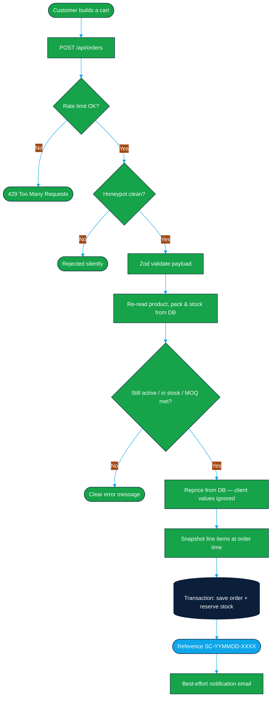
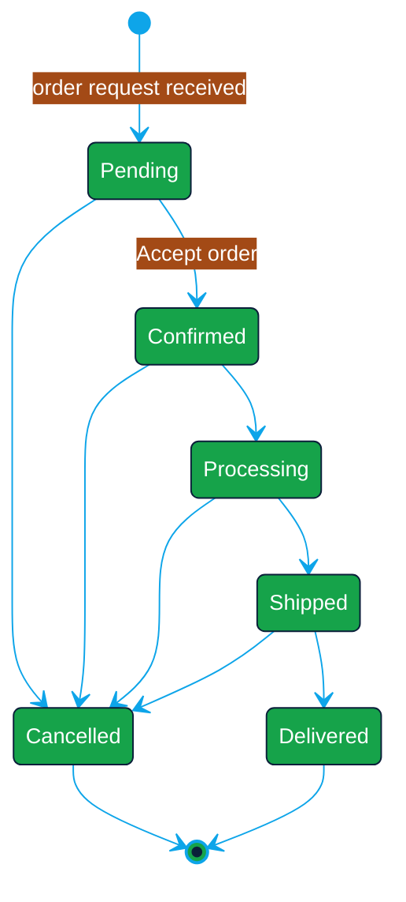

<div align="center">

<!-- ═══════════════════════ ANIMATED HEADER ═══════════════════════ -->


<!-- ═══════════════════════ TYPING ANIMATION ═══════════════════════ -->

<a href="https://jk-industries-supercleaners.vercel.app">
  
</a>

<br />

<!-- ═══════════════════════ BADGES ═══════════════════════ -->

<p>
  
  
  
  
</p>
<p>
  
  
  
  
</p>
<p>
  
  
  
  
</p>

<br />

<!-- ═══════════════════════ QUICK LINKS ═══════════════════════ -->

<p>
  <a href="https://jk-industries-supercleaners.vercel.app"><b>🌐 Live Site</b></a>
  &nbsp;•&nbsp;
  <a href="#⚡-quick-start"><b>⚡ Quick Start</b></a>
  &nbsp;•&nbsp;
  <a href="#🛠️-admin-dashboard"><b>🛠️ Admin</b></a>
  &nbsp;•&nbsp;
  <a href="#🔌-api-reference"><b>🔌 API</b></a>
  &nbsp;•&nbsp;
  <a href="#🚀-deployment"><b>🚀 Deploy</b></a>
</p>

<sub>A responsive, animated wholesale platform for the <b>Super Cleaner</b> cleaning &amp; automotive-care brand.</sub>

</div>

<br />

<div align="center">

<!-- ═══════════════════════ ANIMATED DIVIDER ═══════════════════════ -->


</div>

## 📖 Overview

Retailers, wholesalers and distributors browse a unified catalogue, build a cart across pack-size variants **or wholesale cartons**, and send **order requests**. Everything is managed from a password-protected admin dashboard.

> [!IMPORTANT]
> There are **no online payments**. Orders are *requests* that JK Industries confirms — wholesale pricing, taxes and shipping are agreed separately. There are also **no product categories**, by design.

<div align="center">

|        | Feature | Description |
| :----: | :------ | :---------- |
| 🛒 | **Unified catalogue** | Every product in one filterable, searchable grid — no categories |
| 📦 | **Carton ordering** | Buy by the single pack *or* by the wholesale carton, priced server-side |
| 💬 | **WhatsApp-first** | Click-to-chat enquiries prefilled with product, SKU, pack and quantity |
| 📋 | **Order requests** | Multi-product carts re-priced and re-validated entirely on the server |
| 📊 | **AI insights** | Demand forecasts, restock priority, anomalies — computed from your own data, no API key |
| 🔔 | **Status notifications** | Customers are told the moment an order moves, automatically when possible |
| 📥 | **New-order alerts** | The shop's own WhatsApp gets every new order, in full, the moment it arrives |
| 🌗 | **Light & dark themes** | Every surface tuned for contrast in both, including charts and admin nav |

</div>

<br />

<div align="center">

</div>

## 🧰 Tech stack

<div align="center">

| Layer | Choice |
| :--- | :--- |
| **Framework** | Next.js 16 — App Router, TypeScript, Cache Components |
| **Styling** | Tailwind CSS v4 |
| **Animation** | Motion for React (`motion/react`) |
| **Database** | Prisma 6 → PostgreSQL |
| **Auth** | `bcryptjs` hashing + `jose` HS256 session cookie |
| **Validation** | Zod v4 — shared between client and server |
| **Charts** | Dependency-free SVG (no chart library) |
| **Excel** | `exceljs` |
| **Icons** | `lucide-react` |
| **Storage** | Vercel Blob (with local-disk fallback) |

</div>

> [!NOTE]
> Next.js 16 has breaking changes — Promise-based `params`/`searchParams`, `proxy.ts` instead of `middleware.ts`, and a 2-argument `revalidateTag`. The bundled docs in `node_modules/next/dist/docs/` are the source of truth for this version.

<br />

<div align="center">

</div>

## ⚡ Quick start

**Requirements:** Node.js **20.9+** and npm.

```bash
# 1 — Install dependencies (also runs `prisma generate`)
npm install

# 2 — Configure environment
cp .env.example .env
#     • set DATABASE_URL to your PostgreSQL URL
#     • generate AUTH_SECRET:
node -e "console.log(require('crypto').randomBytes(32).toString('hex'))"
#     • optionally set ADMIN_EMAIL / ADMIN_PASSWORD

# 3 — Create the database and seed it
npm run db:setup

# 4 — Start the dev server
npm run dev
```

Then open **[http://localhost:3000](http://localhost:3000)** for the storefront and **[http://localhost:3000/admin](http://localhost:3000/admin)** for the dashboard.

> [!TIP]
> On Windows PowerShell, use `npm.cmd` if your execution policy blocks `npm.ps1`.

### 📜 Available scripts

| Script | What it does |
| :--- | :--- |
| `npm run dev` | Start the dev server |
| `npm run build` | `prisma generate` + production build |
| `npm run start` | Serve the production build |
| `npm run lint` | ESLint |
| `npm run db:setup` | Push the schema **and** seed |
| `npm run db:push` | Push the Prisma schema (no seed) |
| `npm run db:seed` | Seed admin user, settings and starter products |
| `npm run db:studio` | Open Prisma Studio |

`db:setup` / `db:seed` are **idempotent** — re-running updates existing settings and products and never deletes anything.

<br />

<div align="center">

</div>

## 🗺️ Routes

<details open>
<summary><b>🌐 Storefront</b></summary>

<br />

| Route | Purpose |
| :--- | :--- |
| `/` | Homepage — hero, trust strip, featured products, brand intro, CTA band |
| `/products` | Unified catalogue with search (name / SKU), sort and filters |
| `/products/[slug]` | Product detail — gallery, packs, carton block, enquiry |
| `/cart` | Cart review + order-request form |
| `/track` | Order tracking by mobile number (privacy-minimised) |
| `/about` | Brand story, approach and wholesale info |
| `/contact` | Contact & dealership enquiry form |
| `/order-confirmation/[reference]` | Request received (noindex) |
| `/bill/[reference]` | Public printable bill — reference acts as the access key |
| `/terms` · `/privacy` · `/shipping-returns` | Policy templates |

</details>

<details>
<summary><b>🛠️ Admin dashboard</b></summary>

<br />

| Route | Purpose |
| :--- | :--- |
| `/admin/login` | Sign-in (redirects signed-in admins to `/admin`) |
| `/admin` | Overview — KPI cards, analytics, recent orders & enquiries |
| `/admin/revenue` | Revenue analytics with a switchable range |
| `/admin/insights` | AI insights — forecasts, restock priority, anomalies |
| `/admin/products` | Product list, best-sellers chart, row actions |
| `/admin/products/new` | Create a product |
| `/admin/products/[id]` | Edit a product |
| `/admin/inventory` | Per-pack stock table + stock-level charts |
| `/admin/orders` | Search, filter, Excel export, single & bulk delete |
| `/admin/orders/[id]` | Order detail, status workflow, internal notes, timeline |
| `/admin/orders/[id]/bill` | Printable bill |
| `/admin/enquiries` | Enquiry list, filters, WhatsApp shortcuts, status |
| `/admin/settings` | Site settings + change password |

</details>

<br />

<div align="center">

</div>

## 🔌 API reference

<details open>
<summary><b>Public endpoints</b></summary>

<br />

| Method | Endpoint | Notes |
| :---: | :--- | :--- |
| `POST` | `/api/orders` | Rate-limited · honeypot · Zod · repriced server-side |
| `POST` | `/api/enquiries` | Rate-limited · honeypot · Zod |
| `POST` | `/api/track` | Looks up by mobile; omits address, email and GSTIN |
| `POST` | `/api/auth/login` | bcrypt compare → JWT cookie |
| `POST` | `/api/auth/logout` | Clears the session cookie |

</details>

<details>
<summary><b>Admin endpoints</b> — all require a verified session</summary>

<br />

| Method | Endpoint | Notes |
| :---: | :--- | :--- |
| `GET` | `/api/admin/alerts` | Badge counters — pending orders, new enquiries, low stock |
| `POST` | `/api/admin/upload` | Image upload (MIME + size validated) |
| `DELETE` | `/api/admin/upload?url=` | Delete an uploaded image |
| `PATCH` | `/api/admin/inventory` | Absolute `stock`, relative `delta`, or `mrp` |
| `POST` | `/api/admin/password` | Change password (bcrypt cost 12) |
| `PUT` | `/api/admin/settings` | Persist site settings |
| `POST` | `/api/admin/products` | Create product |
| `PATCH` | `/api/admin/products/[id]` | Full product update |
| `DELETE` | `/api/admin/products/[id]` | Delete — **409** if referenced by order history |
| `POST` | `/api/admin/products/[id]/status` | Show / hide toggle |
| `PATCH` | `/api/admin/orders/[id]` | Status / notes → notifies customer, restores stock on cancel |
| `DELETE` | `/api/admin/orders/[id]` | Delete one order (restores reserved stock first) |
| `POST` | `/api/admin/orders/bulk-delete` | Delete many (max 200), restores stock |
| `GET` | `/api/admin/orders/export` | Excel `.xlsx` — Orders / Items / Summary sheets |
| `PATCH` | `/api/admin/enquiries/[id]` | Update enquiry status |

</details>

<br />

<div align="center">

</div>

## 🧠 How ordering works

<div align="center">



</div>

Key guarantees:

- **Nothing from the client is trusted for money.** `createOrderRequest()` re-reads every product, pack size, availability flag, MOQ, carton size and price from the database.
- **Line items are snapshots.** `productName`, `sku`, `packLabel`, `unitMrp`, `unitWholesale`, `quantity` and `lineTotal` are frozen at order time, so later catalogue edits never rewrite history.
- **Stock is reserved atomically.** Reservations are summed *per pack* before writing, so a single pack and a carton of the same pack can't clobber each other.
- **Cartons reserve what they take.** `OrderItem.stockUnits` records `quantity × unitsPerCarton`, so releasing stock is exact even if the carton size changes later.
- **Duplicate-safe.** Re-submitting the same `clientToken` returns the existing order instead of creating a second one.

<details>
<summary><b>📦 How carton pricing works</b></summary>

<br />

A carton line is a **real, server-priced line** — not a client-side discount:

1. The client only asserts *"this is a carton"*.
2. The server re-derives `unitsPerCarton` and the pack's `wholesalePrice` from the product record.
3. The line is billed at `wholesalePrice × unitsPerCarton` — never MRP.
4. Stock is checked against whole cartons (`floor(stock / unitsPerCarton)`).

If a product has no `unitsPerCarton` or the pack has no wholesale rate, no carton control is shown — bulk buying falls back to a WhatsApp enquiry. This means **a tampered payload cannot buy a carton at MRP or for free.**

</details>

<br />

<div align="center">

</div>

## 🔔 Order status workflow & notifications

<div align="center">



</div>

Every status change messages **the customer's own mobile number from the order** — never a number typed by hand:

<div align="center">

| Priority | Channel | Behaviour |
| :---: | :--- | :--- |
| 1️⃣ | **WhatsApp Business Cloud API** | Sent automatically when `WHATSAPP_ACCESS_TOKEN` + `WHATSAPP_PHONE_NUMBER_ID` are set |
| 2️⃣ | **SMS webhook** | Sent automatically when `SMS_API_URL` + `SMS_API_KEY` are set |
| 3️⃣ | **One-click WhatsApp** | Falls back to a prefilled `wa.me` button the admin presses to send |

</div>

The outcome (`submitted` / `failed` / `manual`) is shown in the panel and recorded permanently in the order's **status timeline**. Notification failures never block the status update, and no delivery receipt is ever claimed — only what the provider actually accepted.

### 📥 New-order alerts to the shop

The moment an order request arrives, the shop is alerted with the **complete** order —
customer, business, mobile, email, GSTIN, full delivery address, every line item with
pack and price, subtotal and customer notes. The recipient is **your** number, never the
customer's, so one order produces exactly one alert and the customer sees nothing.

<div align="center">

| State | What happens |
| :--- | :--- |
| Provider configured | WhatsApp alert sends automatically on every order |
| No provider | `/admin/orders` marks the order **Not alerted** and the order page shows a one-click **Send order alert to my WhatsApp** button |
| Sent successfully | The order is stamped `adminNotifiedAt`, shown as **Alerted** in the table |

</div>

#### Turning automatic alerts on

Automatic WhatsApp is a Meta platform requirement, not an app setting — **no code can
send a WhatsApp message without a WhatsApp Business API account**. The code is already
wired up; it only needs credentials.

1. Create an app at [developers.facebook.com/apps](https://developers.facebook.com/apps)
   and add the **WhatsApp** product.
2. From **WhatsApp → API Setup**, copy the **temporary access token** and the
   **Phone number ID**.
3. Set `WHATSAPP_ACCESS_TOKEN` and `WHATSAPP_PHONE_NUMBER_ID`. Alerts now send
   automatically.
4. Optional — set `WHATSAPP_ADMIN_NUMBER` to deliver alerts to a personal phone while
   the business number stays customer-facing.

> **Why a template matters.** Meta only accepts free-form business-initiated text inside
> a 24-hour window that the recipient opened by messaging the business number. Outside
> it the send is rejected — which is exactly the case for an order placed overnight.
> Create a message template whose body is a single `{{1}}` placeholder, get it approved,
> then set `WHATSAPP_TEMPLATE_NAME` (and `WHATSAPP_TEMPLATE_LANG` if not `en`). The app
> tries free-form text first and falls back to the template, so alerts arrive at any hour.

The temporary token expires after 24 hours; create a **System User** token with
`whatsapp_business_messaging` permission for a permanent one.

<br />

<div align="center">

</div>

## 🛠️ Admin dashboard

> [!WARNING]
> **Change the default credentials before going live.** Set `ADMIN_EMAIL` / `ADMIN_PASSWORD` in `.env` and re-run `npm run db:seed`, or sign in and use **Settings → Change password**.

Sessions last **8 hours** in an httpOnly cookie (`sc_admin_session`). Changing `AUTH_SECRET` invalidates every session.

<details open>
<summary><b>What you can do</b></summary>

<br />

- **Products** — create, edit, deactivate or permanently delete (blocked when a product appears in order history), with image upload, pack sizes, MRP, optional wholesale price, MOQ, units-per-carton, availability, featured flag and a price-visibility toggle.
- **Orders** — search and filter, one-click **Accept → Processing → Shipped → Delivered**, cancel, staff-only internal notes, a notification timeline, Excel export and single/bulk delete with confirmation.
- **Inventory** — inline stock editor (absolute value or ± delta), plus stock-level charts highlighting critical packs.
- **Revenue** — totals, daily and monthly series, by-status breakdown, top products / customers / cities, and prior-period comparison.
- **AI insights** — moving-average demand forecast, days-of-cover, restock priority, z-score anomalies, linear revenue outlook and customer segmentation. **Computed from your own data — no external API key, no per-call cost.**
- **Enquiries** — search, filters, WhatsApp shortcuts and a `new → contacted → resolved` status.
- **Settings** — brand, manufacturer, tagline, hero copy, contact details, WhatsApp number, GSTIN, address, visibility toggles, benefits and social links.
- **Alerts** — a bell that polls every 30s for pending orders, new enquiries and low stock, with optional desktop notifications and a Web-Audio chime.

</details>

> [!NOTE]
> **Products are only ever created or modified from this dashboard.** The public site has no write path to the catalogue — every `/api/admin/*` route requires a verified admin session.

<br />

<div align="center">

</div>

## 🔐 Environment variables

Copy `.env.example` → `.env`.

| Variable | Required | Purpose |
| :--- | :---: | :--- |
| `DATABASE_URL` | ✅ | Prisma connection string (`postgresql://…`) |
| `AUTH_SECRET` | ✅ | Signs admin session cookies. Must be ≥ 16 chars — use a 32-byte random hex string |
| `NEXT_PUBLIC_SITE_URL` | ✅ | Public origin for `sitemap.xml`, `robots.txt` and canonical/OG URLs |
| `ADMIN_EMAIL` | — | Admin email used by the seeder |
| `ADMIN_PASSWORD` | — | Admin password used by the seeder |
| `BLOB_READ_WRITE_TOKEN` | — | Vercel Blob token for image uploads (falls back to local disk) |
| `EMAIL_API_KEY` | — | Enables order-notification emails. Unset = silently skipped |
| `EMAIL_FROM` | — | From address |
| `EMAIL_TO` | — | Admin inbox for order notifications |
| `EMAIL_API_URL` | — | Resend-compatible API base |
| `WHATSAPP_ACCESS_TOKEN` | — | Meta WhatsApp Business Cloud API token → **automatic** messages (customer status + new-order alerts) |
| `WHATSAPP_PHONE_NUMBER_ID` | — | Meta phone-number ID (used with the token above) |
| `WHATSAPP_ADMIN_NUMBER` | — | Optional: send new-order alerts to this number instead of the shop's WhatsApp number |
| `WHATSAPP_TEMPLATE_NAME` | — | Approved `{{1}}`-body template → alerts work outside the 24-hour window |
| `WHATSAPP_TEMPLATE_LANG` | `en` | Language code of the template above |
| `SMS_API_URL` | — | Generic SMS webhook → automatic status messages via SMS |
| `SMS_API_KEY` | — | Bearer token sent to `SMS_API_URL` |

> [!TIP]
> Site content — brand name, WhatsApp number, email, address, GSTIN, hero copy, price visibility — is configured **in the dashboard**, not via env vars.

<br />

<div align="center">

</div>

## 📁 Project structure

```
prisma/
  schema.prisma        Data model — Product, PackSize, Order, OrderItem,
                       OrderEvent, Enquiry, Setting, AdminUser
  seed.ts              Admin user + settings + starter products
public/
  jk-logo.svg          Brand logo
  jk-mark.svg          Brand mark
src/
  app/
    (site)/            Public routes + navbar / footer / cart shell
    admin/             Login page + (dashboard) route group
    api/
      orders | enquiries | track      Public write + lookup endpoints
      auth/login | logout             Session endpoints
      admin/*                         Guarded admin mutations
  components/
    cart | checkout | contact | home | layout | product | ui
    admin/             Admin forms, charts, shell
  lib/
    ai.ts              Insight engine (forecasts, anomalies, segmentation)
    orders.ts          Order lifecycle + server-side repricing + stock
    notify.ts          WhatsApp / SMS / manual fallback notifications
    auth.ts            jose JWT session helpers
    rate-limit.ts      Sliding-window limiter
    validation.ts      Zod schemas
    revenue.ts         Revenue & demand analytics
    products.ts        Cached public product reads
    settings.ts        Site settings read / write
    whatsapp.ts        Click-to-chat message builders
    excel.ts           Workbook export
    ...
  proxy.ts             Next 16 middleware — gates /admin and /api/admin
```

<br />

<div align="center">

</div>

## 🛡️ Security

<div align="center">

| Area | Implementation |
| :--- | :--- |
| **Auth** | bcrypt (cost 12) + signed httpOnly 8-hour session cookie; login never reveals whether an email exists |
| **Route guards** | `proxy.ts` blocks unauthenticated admin requests, and every `/api/admin/*` handler independently re-verifies the session |
| **Validation** | Zod on every request body, server-side; prices, packs, availability and MOQs re-checked against the DB |
| **Rate limiting** | Sliding window per IP — orders `8/min`, enquiries `6/min`, track `10/min`, login `8 per 5 min` |
| **Spam** | Hidden honeypot field on order and enquiry forms |
| **Duplicates** | Idempotent order creation via `clientToken` |
| **Uploads** | MIME + size validated, random non-guessable filenames |
| **History** | Delete refused when a product appears in an order (**409**); deactivate instead |
| **Secrets** | `.env` is git-ignored — never commit `AUTH_SECRET` or DB credentials |
| **Payments** | No payment flow, gateway or card capture anywhere in the project |

</div>

<br />

<div align="center">

</div>

## ⚡ Caching & revalidation

Public reads use Next.js Cache Components (`'use cache'` + `cacheLife` + tags):

| Tag | Applied to | Invalidated by |
| :--- | :--- | :--- |
| `products` | Product lists & detail pages | Any admin product mutation |
| `settings` | Layout, hero, footer, contact | Saving settings |

`admin/*` routes use `export const instant = false` because they read a session on every request. Public product detail pages stream behind `<Suspense>` via partial prerendering.

<br />

<div align="center">

</div>

## 🧪 Testing

```bash
npx tsc --noEmit   # type check
npm run lint       # lint
npm run build      # production build (includes type check)
```

Smoke-tested flows:

- [x] Public pages render with correct titles (home, catalogue, product, about, contact, policies)
- [x] `robots.txt` disallows `/admin`; `sitemap.xml` lists active products
- [x] `/admin` redirects unauthenticated visitors; `/api/admin/*` returns **401** without a session
- [x] Login rejects wrong credentials and sets the cookie on success
- [x] Product create / duplicate-SKU rejection / toggle / edit / delete
- [x] Carton order prices from wholesale × units-per-carton and reserves the right stock
- [x] Deleting a carton order restores exactly the units it reserved
- [x] Settings save, invalid settings → **422**
- [x] Order creation persists with an MRP-computed subtotal and `pending` status
- [x] Cart: add, `localStorage` persistence, quantity stepper, MOQ-aware submit

<br />

<div align="center">

</div>

## 🚀 Deployment

```bash
cp .env.example .env    # set DATABASE_URL, AUTH_SECRET, NEXT_PUBLIC_SITE_URL
npm ci
npm run build
npm run start
```

### Launch checklist

- [ ] `NEXT_PUBLIC_SITE_URL` set to the real HTTPS origin (affects sitemap / OG)
- [ ] `AUTH_SECRET` is a long random value — **not** the development one
- [ ] Admin password changed from the default
- [ ] `.env` never committed
- [ ] Prisma migrations applied for the release
- [ ] A **Vercel Blob store** created, or persistent disk for uploads
- [ ] Real products, images, WhatsApp number, address and GSTIN entered in the dashboard
- [ ] Privacy / Terms / Shipping pages reviewed
- [ ] Optional email provider configured

<br />

<div align="center">

</div>

## ⚠️ Known MVP limitations

| # | Limitation | Notes |
| :-: | :--- | :--- |
| 1 | **Rate limiting is per-instance** | In-memory. Swap `src/lib/rate-limit.ts` for Redis/Upstash before scaling horizontally |
| 2 | **Email is optional** | Without `EMAIL_API_KEY` / `EMAIL_TO`, order emails are skipped silently — orders still save |
| 3 | **Automatic WhatsApp/SMS is optional** | Without provider credentials, the admin sends each status message with one click |
| 4 | **No customer accounts** | By design |
| 5 | **Placeholder content** | Add real products, photos, WhatsApp number, GSTIN and address before launch |
| 6 | **Policy pages are templates** | Have `/privacy`, `/terms` and `/shipping-returns` reviewed for your jurisdiction |

> [!CAUTION]
> Do not publish claims (ingredients, certifications, performance) that you cannot substantiate.

<br />

<div align="center">

</div>

## 🚫 Out of scope

Not included, by agreement: product categories, customer accounts, distributor hierarchies, credit management, salespeople, loyalty programs, a mobile app and online payments.

<br />

<div align="center">

<!-- ═══════════════════════ ANIMATED FOOTER ═══════════════════════ -->


<p>
  <a href="https://jk-industries-supercleaners.vercel.app"><b>Live Site</b></a>
  &nbsp;•&nbsp;
  <a href="#🛠️-admin-dashboard"><b>Admin</b></a>
  &nbsp;•&nbsp;
  <a href="#⚡-quick-start"><b>Quick Start</b></a>
</p>

<sub>Built with ☕ and a lot of <code>npm run build</code>.</sub>

<br /><br />


</div>
